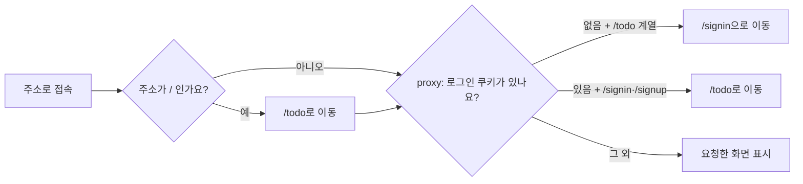
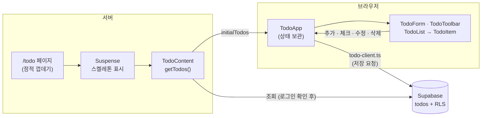
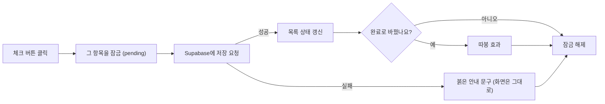

# Todo (Next.js + Supabase)

React와 Next.js(App Router)로 만든 회원 전용 Todo List입니다. 이전에 구현한 [JavaScript 과제에서 만들었던 Todo List](https://github.com/eeseuju/KANT-JavaScript-assignment)를 Next.js로 옮기고, Supabase로 회원가입·로그인과 데이터 저장을 붙였습니다.

- 기술 스택 : Next.js 16 (App Router) · React 19 · TypeScript · Tailwind CSS 4 · Supabase (Auth, Postgres, RLS) · Vercel

<br>

## 1. 구성 화면 (라우트)

<table>
  <tr>
    <th width="50%">로그인 · <code>/signin</code></th>
    <th width="50%">회원가입 · <code>/signup</code></th>
  </tr>
  <tr>
    <td align="center"><br>이메일과 비밀번호로 로그인합니다.</td>
    <td align="center"><br>이메일과 비밀번호로 가입하면 바로 로그인됩니다.</td>
  </tr>
  <tr>
    <th>할 일 목록 · <code>/todo</code></th>
    <th>할 일 상세 · <code>/todo/[id]</code></th>
  </tr>
  <tr>
    <td align="center"><br>내 할 일 목록입니다. (회원 전용)</td>
    <td align="center"><br>할 일 한 개의 상세 정보입니다. (회원 전용, 동적 라우트)</td>
  </tr>
  <tr>
    <td colspan="2" align="center"><code>/</code> → <code>/todo</code>로 이동합니다. (화면 없음)</td>
  </tr>
</table>

<br>

## 2. 주요 기능

| 기능 | 설명 |
|---|---|
| 회원 기능 | 회원가입 · 로그인 · 로그아웃 기능은 이메일과 비밀번호로 인증합니다. (Supabase Auth) |
| 할일 목록 | 로그인하지 않으면 `/todo`에 들어갈 수 없고 `/signin`으로 이동합니다. |
| 할일 관리 | 추가, 완료 체크, 수정(제목·날짜·시간·내용), 삭제 |
| 상세 화면 | `/todo/[id]`, 없거나 남의 할 일이면 404 화면을 보여 줍니다. |
| 할일 조회 | 검색(제목·내용), 상태 필터(전체·진행·완료), 정렬(최신 등록순·기한 빠른순), 완료 개수 |
| 기한 표시 | 기한이 지난 할 일은 주황색과 "지남" 글자로 상태를 강조합니다. |
| 상태 화면 | 로딩(스켈레톤), 성공, 오류(다시 시도), 빈 목록, 검색 결과 없음 |

<br> 

## 3. 프로젝트 구조

```text
src/
├─ proxy.ts                  요청 전 1차 접근 제어 (/todo, /signin, /signup)
├─ app/
│  ├─ layout.tsx             공통 틀 (글꼴, 언어)
│  ├─ page.tsx               / → /todo 이동
│  ├─ globals.css            Tailwind 설정과 공통 버튼·입력 스타일
│  ├─ signin/                로그인 화면
│  ├─ signup/                회원가입 화면
│  └─ todo/
│     ├─ page.tsx            할 일 목록
│     ├─ error.tsx           오류 화면 (다시 시도)
│     └─ [id]/               할 일 상세 (동적 라우트, 없으면 404)
├─ components/               화면 조각 (TodoApp, TodoItem, TodoToolbar, AuthForm …)
├─ hooks/useToday.ts         오늘 날짜 (자정에 갱신)
├─ lib/
│  ├─ supabase/              브라우저·서버·proxy용 Supabase 클라이언트
│  ├─ todos.ts               서버에서 목록·상세 조회
│  ├─ todo-client.ts         브라우저에서 추가·수정·삭제 저장
│  └─ auth.ts                접근 제어 규칙
├─ types/todo.ts             Todo 타입
└─ sql/                      테이블·RLS 생성 SQL, 예시 데이터
```

<br>

## 4. 동작 흐름

### 4-1. 화면 이동과 접근 제어



### 4-2. 데이터 흐름



### 4-3. 할일 완료 체크 동작



<br>

## 5. 렌더링 방식 (서버 / 클라이언트)

| 대상 | 종류 | 설명 |
|---|---|---|
| `layout`, `AppCard`, `AppHeader`, `Icon`, 로딩 화면 | 서버 | 상태와 이벤트가 없는 틀 |
| `/signin`, `/signup` | 서버 + `AuthForm`(클라이언트) | 카드 틀은 서버에서 입력·제출 이벤트만 클라이언트 |
| `/todo`, `TodoContent` | 서버 | 로그인 쿠키로 DB를 조회하고 할일 목록만 `<Suspense>`로 스트리밍 |
| `TodoApp`, `TodoForm`, `TodoEditForm`, `TodoToolbar` | 클라이언트 | 입력 상태(`useState`)와 클릭·제출 이벤트 |
| `TodoList`, `TodoItem` | `TodoApp` 안에서 동작 | 훅 없이 이벤트 함수를 받아 `TodoApp`과 함께 브라우저에서 동작 |
| `/todo/[id]`, `TodoDetail` | 서버 | 읽기 전용, 주소의 `id`(params)는 요청 때 `<Suspense>` 안에서 조회 |
| `error.tsx` | 클라이언트 | 오류 화면(error boundary)은 클라이언트 컴포넌트여야 하고 "다시 시도" 클릭을 처리 |
| `proxy.ts` | 요청 전 검문 | 페이지가 그려지기 전에 쿠키만 읽는 가벼운 1차 접근 제어 |

<br>

## 6. React Hook 사용 내역

| 파일 | 사용한 훅 | 규칙 점검 |
|---|---|---|
| `TodoApp` | `useState`, `useMemo`, `useCallback` | 의존성 배열과 `setXxx((prev) => ...)`로 최신 상태 사용 |
| `useToday` | `useSyncExternalStore` | 서버는 `null`, 브라우저는 오늘 날짜로 하이드레이션 오류를 막음 |
| `TodoToolbar` | `useState` | 입력 중인 검색어와 적용된 검색어 분리 |
| `TodoEditForm` | `useId`, `useState`, `useRef`, `useEffect` | `useEffect(…, [])`로 처음 한 번만 커서 이동 |
| `TodoForm` | `useState` | 제출 중 중복 클릭 방지 |
| `AuthForm`, `SignoutButton` | `useState`, `useRouter` | `try / catch / finally`로 로딩·오류 상태 처리 |
| `error.tsx` | `useEffect` | 의존성 `[error]` |

<br>

## 7. 데이터 페칭 전략과 성능

- **첫 조회는 서버에서** : `TodoContent`가 `getTodos()`로 Supabase를 조회하고, 결과를 `TodoApp`에 `initialTodos`로 넘깁니다. 로그인 쿠키를 읽는 부분만 `<Suspense>` 안에 두어, 정적 껍데기를 먼저 보여 주고 목록을 스트리밍합니다. (Cache Components 사용)  

- **변경은 브라우저에서** : 추가·체크·수정·삭제는 브라우저용 Supabase 클라이언트로 저장하고, 저장에 성공하면 화면 상태를 바로 바꿉니다. 요청 중에는 그 항목의 버튼을 막고(`pending`), 실패하면 오류 문구를 보여 줍니다.  

- **보안은 여러 겹으로** : `proxy`(1차, 쿠키 확인) → 서버 조회 함수의 `getClaims()`(2차, 서명 검사) → 데이터베이스 RLS(최종, 내 행만 접근)  

- **어플리케이션 성능** : 정적 껍데기 + 스트리밍, `memo`·`useMemo`·`useCallback`으로 불필요한 다시 그리기를 줄이고 검색·필터·정렬은 이미 받은 목록에서 브라우저가 처리합니다.  

- **네비게이션 UI/UX**: `Link`로 페이지 전체를 새로 불러오지 않으면서 이동하고, 이동하면 스켈레톤이 바로 보입니다. 상세에는 "← 목록으로" 버튼이 있고, 잘못된 주소는 404 화면으로 안내합니다.

<br>

## 8. 실행 방법

### 8-1. 로컬 실행
```bash
npm install
# Windows PowerShell: Copy-Item .env.example .env.local
cp .env.example .env.local
# .env.local에 Supabase 주소와 공개 키 입력
# Supabase SQL Editor에서 src/sql/todos.sql을 실행해 테이블과 RLS 생성
npm run dev
```

이 프로젝트에서 사용하는 환경변수는 아래와 같습니다.

| 이름 | 설명 |
|---|---|
| `NEXT_PUBLIC_SUPABASE_URL` | Supabase 프로젝트 주소 |
| `NEXT_PUBLIC_SUPABASE_PUBLISHABLE_KEY` | Supabase 공개 키(publishable key) |

### 8-2. 배포 정보

- 배포 주소: https://kant-react-next-js-assignment.vercel.app